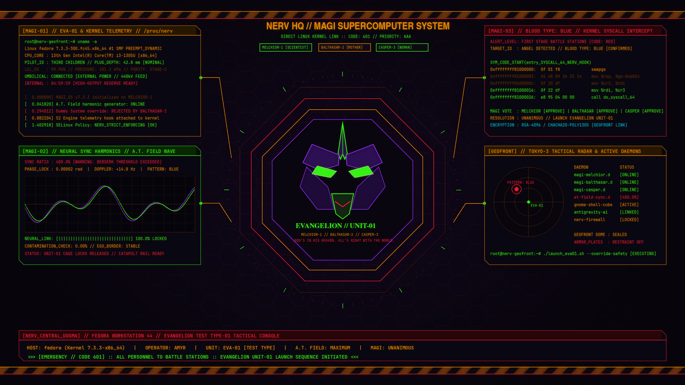
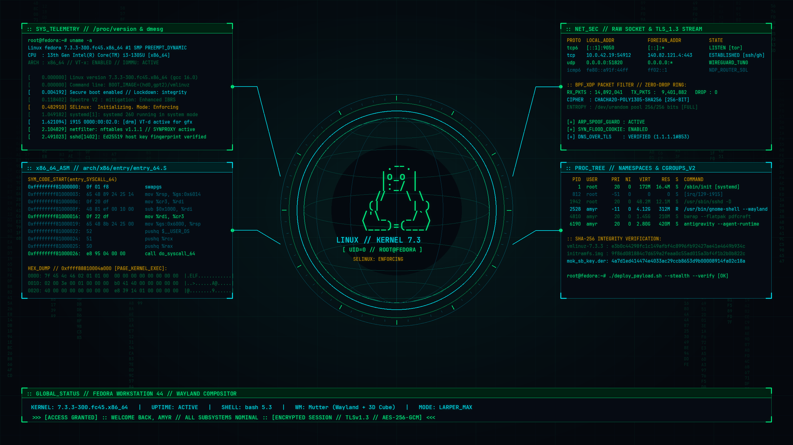

# 🕷️ Fedora GNOME Larper Rice — Gen'ei Ryodan // No.0 (Chrollo Edition)

Setup completo de customização (**Rice / Linux Larper**) para **Fedora Workstation (GNOME Wayland)** inspirado em **Hunter x Hunter (Chrollo Lucilfer / Trupe Fantasma)**, combinando:
- **Cubo 3D + Skybox 360° + Transição Hacker GLSL** (`Desktop Cube` + extensão custom `Hacker Workspace Transition` com glitch cromático, chuva Matrix, scanlines laser e HUD tático em Cairo ao trocar de área de trabalho)
- **Janelas em Vidro Fosco (Blur + Transparência)** no Terminal (`Ptyxis`) e Gerenciador de Arquivos (`Nautilus`)
- **Efeitos Hacker de Janela (`Burn My Windows`)**: aleatorizando `Glitch` (`#00ff88`), `Matrix`, `TV Glitch` (`#a855f7`) e `Hexagon` ao abrir/fechar janelas + **Janelas Elásticas** (`Compiz Wobbly Windows`)
- **Fastfetch Customizado** com a Aranha de 12 patas + Cruz Invertida (`GEN'EI RYODAN // NO.0`) e HUD de telemetria (`[SKILL HUNTER // SYS.HUD]`)
- **Prompt Starship** de 2 linhas em roxo/carmesim com ícones **JetBrainsMono Nerd Font**
- **Skill Hunter Deck (`larper`)**: Painel multiplexado em 4 quadrantes no `tmux` rodando `fastfetch`, `btop`, `matrix --purple` e `pipes` simultaneamente com consumo quase zero de RAM (~24 MB).

---

## 🖼️ Wallpapers Inclusos

| Hunter x Hunter (Chrollo Lucilfer) | Evangelion NERV // MAGI HUD | Linux Kernel Cyber HUD |
| :---: | :---: | :---: |
|  |  |  |

---

## 🖥️ Preview do Terminal (`fastfetch`)

```text
                                        ╭─── 󰣛 user@fedora ─── [SKILL HUNTER // SYS.HUD] ───╮
       ▄▀                       ▀▄      │ 󰣛 Distro   ❯ Fedora Linux Workstation Edition
     █   ▄▀       ▄▀ ▀▄       ▀▄   █    │ 󰌽 Kernel   ❯ Linux 7.x x86_64
    █   █   ▄▀   ▄█████▄   ▀▄   █   █   │ 󱂬 WM/Comp  ❯ Mutter (Wayland)
    █  █   █  ▀▄███▀█▀███▄▀  █   █  █   │ 󰆍 Shell    ❯ bash
     █  █   ▀▄  ▀███████▀  ▄▀   █  █    │  Term     ❯ Ptyxis
      ▀  █  ▄▀▀▀▄███████▄▀▀▀▄  █  ▀     │ 󰏖 Pkgs     ❯ rpm + flatpak
        ▄▀ █   ████▄█▄████   █ ▀▄       │ 󰅐 Uptime   ❯ 1 day, 32 mins
       █  █   █████▀█▀█████   █  █      ├────────────── [ TELEMETRY // HARDWARE ] ──────────────┤
       █  █  ███████▀███████  █  █      │ 󰻠 CPU      ❯ Intel Core (6T) @ 3.30 GHz
       █  █  ███████▄███████  █  █      │ 󰢮 GPU      ❯ Intel UHD Graphics
       █  ▀▄  █████▀█▀█████  ▄▀  █      │ 󰍛 Memory   ❯ [ █████░░░░░░░░░ ] 3.75 GiB / 11.36 GiB (33%)
       ▀▄  ▀▄  ███████████  ▄▀  ▄▀      │ 󰋊 Disk     ❯ [ █░░░░░░░░░░░░░ ] 20.66 GiB / 474.35 GiB (4%)
        ▀▄  █   ▀███████▀   █  ▄▀       │ 󰁹 Battery  ❯ [ ████████░░░░░░ ] (80%)
          ▀▄▀▄    ▀▀█▀▀    ▄▀▄▀         ╰───────────────────────────────────────────────────────╯
              ▀▄         ▄▀               ● ● ● ● ● ● ● ●
       ── GEN'EI RYODAN // NO.0 ──
```

---

## ⚡ Clonar Meu OS Inteiro em 1 Comando

Se você usa **Fedora Workstation (GNOME)** (ou outra distro GNOME 45+ como Ubuntu/Arch), cole **este único comando** no terminal:

```bash
curl -fsSL https://raw.githubusercontent.com/amyrindequi-design/fedora-gnome-larper-rice/main/install.sh | bash
```

O instalador faz tudo sozinho (e ainda cria backup dos seus dotfiles antigos em `~/.config/larper-backup-*`):
- Verifica/instala dependências básicas (`tmux`, `unzip`, `xz`, `glib2`, etc.) se faltarem.
- Instala `fastfetch`, `starship`, `btop`, `yazi` e a **JetBrainsMono Nerd Font**.
- Copia os scripts (`larper`, `matrix`, `pipes`, `gerar-skybox.py`) e todas as configs do terminal/tmux.
- Aplica os wallpapers (incluindo o **Skybox 360°**), tema escuro, fonte, botões de janela, **Ptyxis transparente**, **Blur my Shell**, **Desktop Cube**, **Burn My Windows** (`Glitch` + `Matrix` + `TV Glitch` + `Hexagon`) e **O-Tiling**.
- Baixa/ativa todas as extensões do GNOME + instala e compila a extensão custom **`hacker-transition@amyrindequi.github.io`** (shader GLSL + HUD tático Cairo).

Depois que terminar:
1. Abra um novo terminal para ver o **Fastfetch + Starship** e digite `larper` para abrir o **Skill Hunter Deck**.
2. Encerre a sessão e entre novamente no GNOME para ativar todas as extensões visuais (**Cubo 3D + Transição Hacker + Blur**).

> *(Alternativa manual via `git clone`: `git clone https://github.com/amyrindequi-design/fedora-gnome-larper-rice.git && bash fedora-gnome-larper-rice/install.sh`)*

---

## 🛠️ Tutorial Passo a Passo (Como deixar igual manualmente)

Caso queira configurar parte por parte ou adaptar em outra distro Linux com GNOME:

### 1. Instalar a Fonte (`JetBrainsMono Nerd Font`)
Os ícones do terminal (`󰣛`, `󰌽`, `󰻠`, ``) precisam de uma **Nerd Font**:
```bash
mkdir -p ~/.local/share/fonts/JetBrainsMonoNerd
curl -sL "https://github.com/ryanoasis/nerd-fonts/releases/latest/download/JetBrainsMono.tar.xz" \
  | tar -xJ -C ~/.local/share/fonts/JetBrainsMonoNerd/
fc-cache -f ~/.local/share/fonts/JetBrainsMonoNerd/
```
Para ativar no terminal padrão do Fedora (**Ptyxis**):
```bash
gsettings set org.gnome.Ptyxis use-system-font false
gsettings set org.gnome.Ptyxis font-name 'JetBrainsMono Nerd Font 10.5'
```

---

### 2. Deixar o Terminal e o Gerenciador de Arquivos Transparentes (Vidro Fosco)
1. Instale a extensão **Blur my Shell** (`blur-my-shell@aunetx`) pelo **Extension Manager**.
2. Carregue as configurações de transparência (que ativam o blur no `Nautilus` e no `Ptyxis` e impedem que o modo de economia de bateria desligue a transparência):
```bash
dconf load /org/gnome/shell/extensions/blur-my-shell/ < gnome/blur-my-shell.dconf
dconf load /org/gnome/Ptyxis/ < gnome/ptyxis.dconf
```

---

### 3. Ativar o Cubo 3D, Transição Hacker GLSL e Efeitos de Janela no GNOME
Instale pelo **Extension Manager** (ou pelo site [extensions.gnome.org](https://extensions.gnome.org)) as extensões:
- **Desktop Cube** (`desktop-cube@schneegans.github.com`) — Troca de área de trabalho em cubo 3D com parallax e skybox panorâmico 360°.
- **Burn My Windows** (`burn-my-windows@schneegans.github.com`) — Desintegra janelas com efeitos `Glitch`, `Matrix`, `TV Glitch` e `Hexagon` em `#00ff88` e `#a855f7`.
- **Hacker Workspace Transition** (`gnome/extensions/hacker-transition@amyrindequi.github.io`) — Extensão custom GNOME 45–51 incluída neste repo: aplica shader GLSL (`HackerGlitchShader`) + HUD tático Cairo (`SYS://CUBE_BUS NODE_0X >> NODE_0Y`) nas transições de área de trabalho junto com o Cubo 3D.
- **Compiz windows effect** (`compiz-windows-effect@hermes83.github.com`) — Janelas elásticas/gelatinosas ao arrastar.
- **Dash to Dock** (`dash-to-dock@micxgx.gmail.com`) + **Transparent Top Bar** (`transparent-top-bar@ftpix.com`) + **O-Tiling** (`o-tiling@oliwebd.github.com`).

Aplique os ajustes finos do Cubo 3D, Skybox, Burn My Windows e instale a extensão local:
```bash
# Fixar 4 áreas de trabalho para formar as 4 faces do cubo 3D
gsettings set org.gnome.mutter dynamic-workspaces false
gsettings set org.gnome.desktop.wm.preferences num-workspaces 4

# Carregar configurações 3D (parallax, separação, explosão 3D e skybox 360°)
dconf load /org/gnome/shell/extensions/desktop-cube/ < gnome/desktop-cube.dconf
dconf write /org/gnome/shell/extensions/desktop-cube/background-panorama "'$HOME/Imagens/Wallpapers-Linux/cube-skybox-geneiryodan.png'"

# Instalar extensão custom Hacker Workspace Transition
mkdir -p ~/.local/share/gnome-shell/extensions/hacker-transition@amyrindequi.github.io
cp -r gnome/extensions/hacker-transition@amyrindequi.github.io/* ~/.local/share/gnome-shell/extensions/hacker-transition@amyrindequi.github.io/
glib-compile-schemas ~/.local/share/gnome-shell/extensions/hacker-transition@amyrindequi.github.io/schemas/

# Copiar perfil Glitch + Matrix + TV Glitch + Hexagon para o Burn My Windows
mkdir -p ~/.config/burn-my-windows/profiles
cp configs/burn-my-windows/profiles/chrollo-larper.conf ~/.config/burn-my-windows/profiles/1700000000.conf
dconf write /org/gnome/shell/extensions/burn-my-windows/active-profile "'$HOME/.config/burn-my-windows/profiles/1700000000.conf'"
```

---

### 4. Configurar o Fastfetch (`Gen'ei Ryodan // No.0`) e Prompt Starship
Copie os arquivos da pasta `configs/`:
```bash
mkdir -p ~/.config/fastfetch ~/.config/btop
cp configs/fastfetch/config.jsonc ~/.config/fastfetch/config.jsonc
cp configs/fastfetch/logo.txt ~/.config/fastfetch/logo.txt
cp configs/starship.toml ~/.config/starship.toml
cp configs/btop/btop.conf ~/.config/btop/btop.conf
cp configs/.tmux.conf ~/.tmux.conf
cp configs/.bashrc ~/.bashrc
```

---

### 5. Instalar os Scripts do Painel `larper` (`matrix`, `pipes`, `larper`)
```bash
mkdir -p ~/.local/bin
cp scripts/larper scripts/matrix scripts/pipes ~/.local/bin/
chmod +x ~/.local/bin/larper ~/.local/bin/matrix ~/.local/bin/pipes
```

---

## 🎮 Comandos e Atalhos Disponíveis

| Comando / Atalho | O que faz |
| :--- | :--- |
| `larper` | Abre o **Skill Hunter Deck** em 4 painéis no `tmux` (`fastfetch` + `btop` + `matrix --purple` + `pipes`) |
| `fetch` | Limpa o terminal e exibe a arte da Trupe Fantasma + telemetria do sistema |
| `matrix-chrollo` | Chuva digital estilo Matrix em roxo/vermelho (`q` para sair) |
| `matrix` / `matrix --red` | Chuva Matrix verde clássica ou vermelha (`q` para sair) |
| `pipes` | Protetor de tela de tubulações neon no terminal (`q` para sair) |
| `btop` (ou `top`) | Monitor de hardware em Braille com fundo transparente (`q` para sair) |
| `yazi` (ou `files`) | Gerenciador de arquivos no terminal controlado pelas setas (`q` para sair) |
| `Ctrl + Alt + ← / →` | Gira o **Cubo 3D** entre as áreas de trabalho |
| **Arrastar área vazia do desktop** | Gira o **Cubo 3D** livremente em 360° com o mouse |

---

## 📂 Estrutura do Repositório

```text
├── configs/
│   ├── .bashrc                                    # Aliases + inicialização do fastfetch e starship
│   ├── .tmux.conf                                 # Barra superior GEN'EI RYODAN + suporte a mouse
│   ├── starship.toml                              # Prompt futurista de 2 linhas em roxo/carmesim
│   ├── btop/btop.conf                             # Configuração transparente em Braille do btop
│   ├── burn-my-windows/profiles/chrollo-larper.conf # Efeitos Glitch + Matrix + TV Glitch + Hexagon
│   └── fastfetch/
│       ├── config.jsonc                           # Layout [SKILL HUNTER // SYS.HUD]
│       └── logo.txt                               # Arte ASCII Aranha Nº 0 + Cruz Invertida
├── gnome/
│   ├── extensions/
│   │   └── hacker-transition@amyrindequi.github.io/ # Extensão custom GLSL + HUD tático Cairo
│   ├── blur-my-shell.dconf                        # Blur no Nautilus, Ptyxis, Dock e Painel
│   ├── desktop-cube.dconf                         # Parallax 3D, Skybox e separação de faces do Cubo
│   ├── burn-my-windows.dconf                      # Perfil ativo de efeitos de janela
│   ├── compiz-windows-effect.dconf                # Janelas gelatinosas / elásticas
│   ├── dash-to-dock.dconf                         # Configurações da dock
│   ├── o-tiling.dconf                             # Tiling de janelas e atalhos
│   ├── caffeine.dconf                             # Configurações do Caffeine
│   ├── clipboard-indicator.dconf                  # Atalho <Super>v do histórico da área de transferência
│   ├── ptyxis.dconf                               # Fonte Nerd Font + opacidade 84% no terminal
│   └── enabled-extensions.txt                     # Lista de extensões GNOME utilizadas
├── scripts/
│   ├── gerar-skybox.py                            # Gerador do Skybox 360° Gen'ei Ryodan
│   ├── larper                                     # Launcher do painel 4-em-1 no tmux
│   ├── matrix                                     # Chuva Matrix em Katakana (verde/roxo/vermelho)
│   └── pipes                                      # Animação de tubulações neon no terminal
├── wallpapers/
│   ├── chrollo-hunter-x-hunter.jpg                # Wallpaper principal Chrollo Lucilfer
│   ├── cube-skybox-geneiryodan.png                # Skybox 360° do Cubo 3D (Gen'ei Ryodan)
│   ├── evangelion-nerv-magi-hud.png               # Wallpaper custom Evangelion NERV / MAGI
│   └── linux-kernel-cyber-hud.png                 # Wallpaper custom Linux Kernel Cyber HUD
└── install.sh                                     # Instalador automático em 1 comando
```
